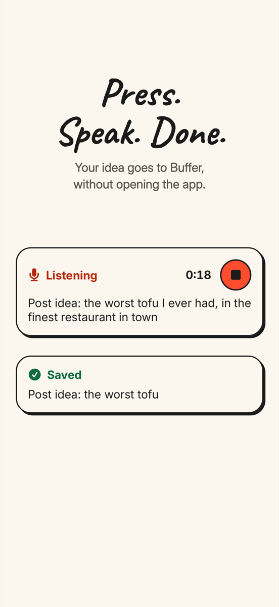
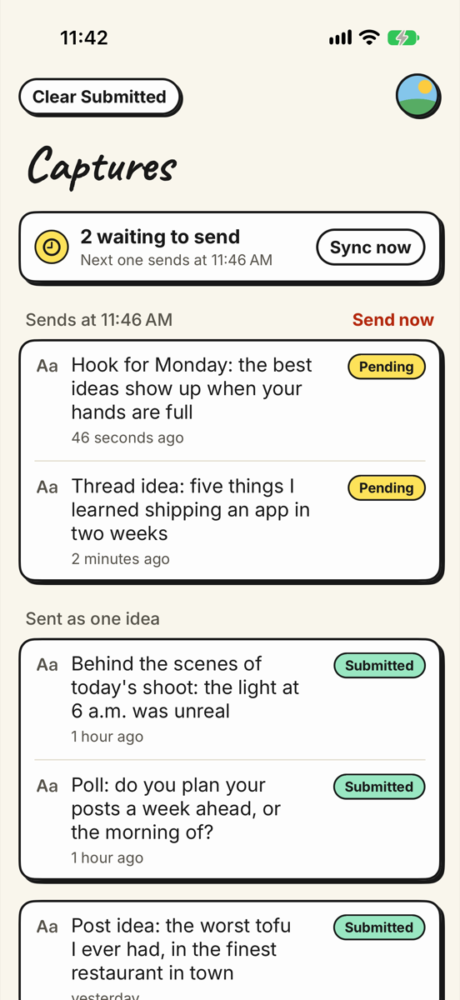
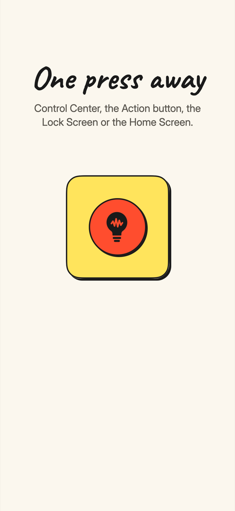
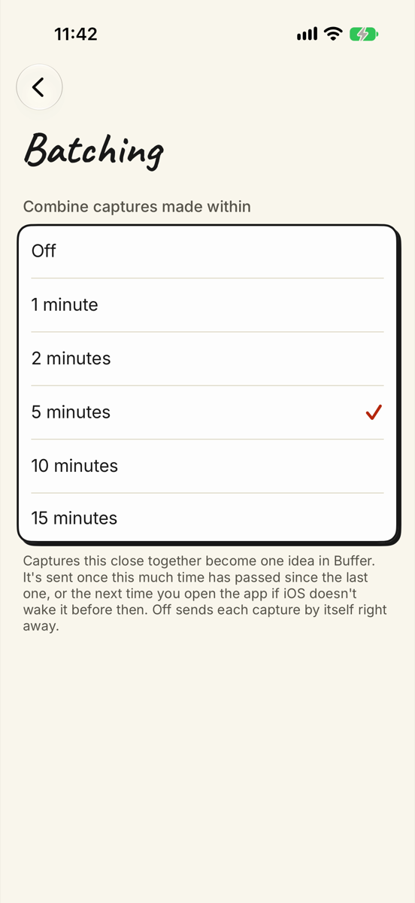

# buffer-snap
A minimal iOS app that gives you the most frictionless way to capture any inspiration into Buffer Create on the go.

[Download on the App Store](https://apps.apple.com/app/id6830422547). It's free and open source under the [MIT license](LICENSE). Found a problem
or have an idea? [Open an issue](https://github.com/southp/buffer-snap/issues).

  
  
  
  

## Context
Inspiration is naughty. They come when you are lifting weights in a gym, eating the worst tofu in a fine dining, walking alongside a street carrying stuff with only one finger free, or being tripped over in a hike and seeing the most beautiful flower you've ever seen. 

At least for me, it never comes when I sit still and have all the creation tools at hands. I wish I'd have a quick way to capture the idea, even in its roughest form. Ironically, my iPhone is the only thing that's always with me even when I was tripped over in a hike. That's why I'm exploring this idea.

## How it works
The goal is the fewest touches between an idea and Buffer Create.

**Press, speak, done.** Press "Dictate an Idea" on the Action button, in Control Center or in the Lock Screen's bottom buttons, or tap the mic widget on the Home Screen, and say the idea. The app stays closed: the words show live in the Dynamic Island and on the Lock Screen, and it's saved and sent once you press again, tap Stop, or pause for 3 seconds. [Testing on a real iPhone](https://github.com/southp/buffer-snap/issues/57#issuecomment-6715563614) proved it works, and [why it's built this way](docs/decisions/58-dictate-outside-app.md).

Capture starts once the phone is unlocked, which with Face ID is usually just a glance. [Testing on a real iPhone](docs/spikes/locked-capture.md) showed what iOS allows on a locked phone, and [why we don't build on it](docs/decisions/10-unlocked-capture.md).

1. Dictate without opening the app, as above. It's the only way to capture.
2. The main app provides the following.
   1. Authenticate the API access through a Buffer account, when you want ideas sent. Until then the app is in offline mode: everything stays on this iPhone and capturing works the same.
   2. View what's being captured
   3. Manage what's being captured
      1. Resend
      2. Delete
      3. No edit
   4. There will be no sync to Buffer Create. That's not the purpose of this app.
   5. The app keeps at most 500 captures, dropping the oldest ones already sent to Buffer first. An unsent one is never
      dropped ([why](docs/decisions/46-storage-limit.md)).
3. What can be captured. Nothing is captured inside the app: someone who has to open an app to type can open Buffer and type there.

   | Capture | How | When |
   |---|---|---|
   | Dictated text | Press the control or a widget, speak, press again or pause | 1.0 |
   | Multiple pictures | One camera session: each shot adds a thumbnail to a strip in the corner, and you end it like a regular camera app. Buffer's API needs public URLs for images, so this depends on a hosting decision | Planned |

4. Smart batching: captures with less than 5 minutes between them (configurable) become one Buffer Create idea.
5. Submission to Buffer Create is an offline-first experience: After each capture, the app stores the item locally. A background job submits each batch when its window ends, with exponential back-off retries. iOS doesn't guarantee a background wake-up, so a batch may wait until the app next opens, and "Send now" sends it early.

## Releases
What each version brought, and what's next: [release notes](docs/release-notes.md).

## Development
Building, testing and deploying all run from the terminal: see [`docs/development.md`](docs/development.md).
