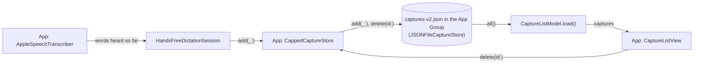
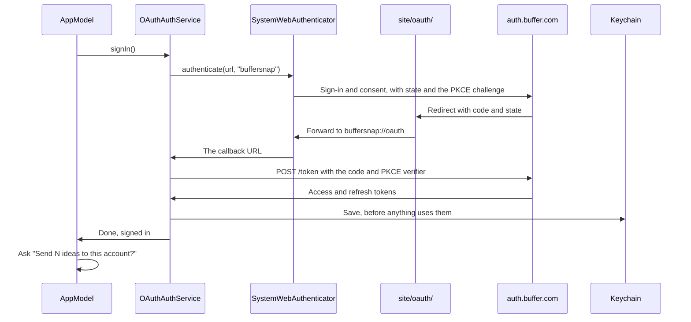
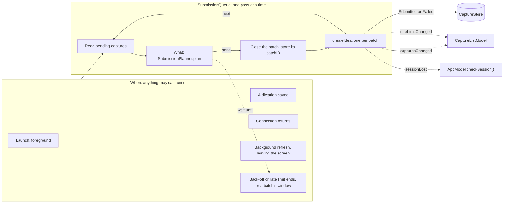
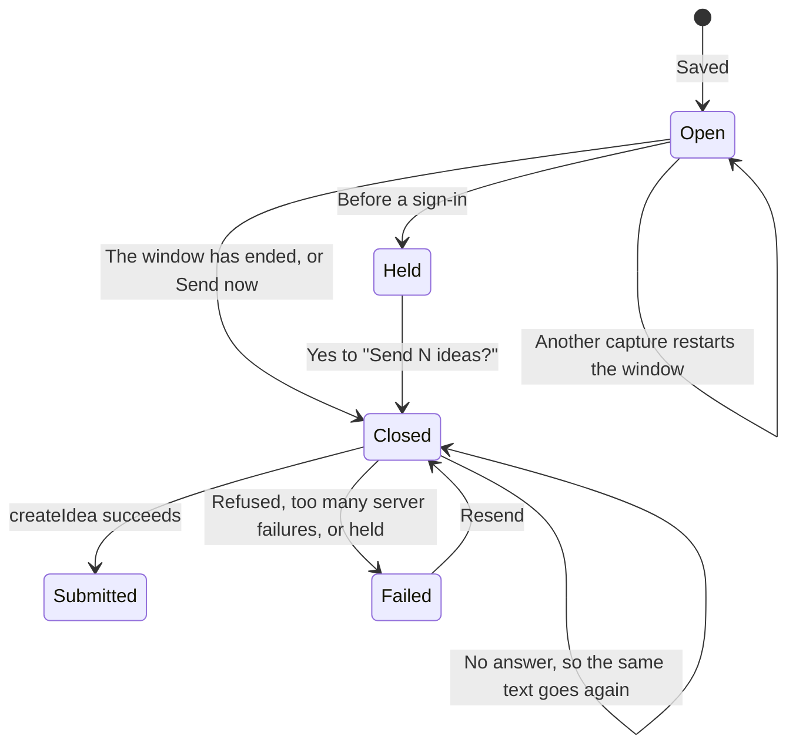
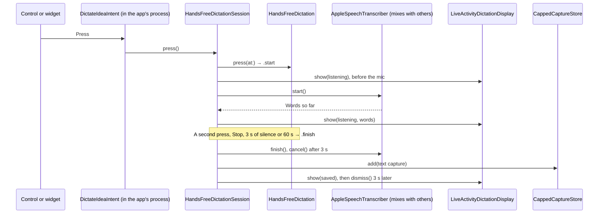

# Architecture

BufferSnap keeps its logic in **BufferSnapCore** (`Packages/BufferSnapCore`), a pure-Swift package with no UI
frameworks, so `just test-core` tests it on macOS in seconds without a simulator. The app and the widget are thin
SwiftUI shells over it.

- **Features** are `@Observable @MainActor` view models (`AppModel`, `CaptureListModel`, `BatchingSettingsModel`):
  they hold the state and the actions on it. Dictating outside the app, the only way to capture, is
  `HandsFreeDictation`, a pure state machine, run by `HandsFreeDictationSession`.
- **Services** are `Sendable` protocols with `async throws` methods (`CaptureStore`, `AuthService`,
  `SpeechTranscriber`, `BufferClient`, `ConnectivityMonitor`, `BatchWindowSetting`). Each one starts with a mock or
  in-memory implementation, and a real one replaces it later without touching the models. `JSONFileCaptureStore`,
  `OAuthAuthService`, `GraphQLBufferClient` and `NetworkPathConnectivityMonitor` are the real ones so far.
  `SubmissionQueue` is an actor on top of them. `AppleSpeechTranscriber` lives in the app rather than Core, because
  `AVAudioSession` doesn't exist on macOS, where Core's tests run.
- **`AppEnvironment`** bundles the services. `BufferSnapApp` builds it once, as the composition root, and is the
  only place that picks which implementations run.
- **Models** are plain `Sendable` values (`Capture`, `AppVersion`). `ProjectLinks` holds where the app's help and code
  live. `DictationPlacement` lists where Dictate an Idea can go and the steps to put it there, which the How to Add
  guide shows.
- **Views** (`App/Views/`) only render. `RootView` shows the capture list, signed in or not, and it's the only screen.
  Signing in is a row on the list. A screen feeds a stateless view (`CaptureListView`) plain values and closures, and
  `CaptureListScreen` owns its feature model. Conventions: [`App/CLAUDE.md`](../App/CLAUDE.md).
- **The widget** (`Widget/`) is a WidgetKit extension: the "Dictate an Idea" control and the "Dictate an Idea" widget.
  Both run `DictateIdeaIntent` (`Shared/`, compiled into both the app and the widget), which dictates without opening
  the app, and the extension draws its Live Activity. Conventions: [`Widget/CLAUDE.md`](../Widget/CLAUDE.md).

Why: [`5-spm-core.md`](decisions/5-spm-core.md), [`5-core-ui-import-lint.md`](decisions/5-core-ui-import-lint.md).

## Layers

Arrows point from a layer to what it uses.

```mermaid
flowchart TD
    subgraph shells["UI shells (SwiftUI)"]
        App["App: BufferSnapApp → RootView<br/>(CaptureListScreen, BatchingSettingsScreen)"]
        Widget["Widget: DictateWidget, DictateIdeaControl"]
        Intent["Shared: DictateIdeaIntent"]
        AppleSpeech["App: AppleSpeechTranscriber"]
    end

    subgraph core["BufferSnapCore (no UI imports)"]
        Env["AppEnvironment"]
        subgraph features["Features"]
            AppModel["AppModel"]
            Session["HandsFreeDictationSession"]
            CaptureListModel["CaptureListModel"]
            BatchingSettings["BatchingSettingsModel"]
        end
        subgraph services["Services (protocols)"]
            CaptureStore["CaptureStore"]
            AuthService["AuthService"]
            SpeechTranscriber["SpeechTranscriber"]
            BufferClient["BufferClient"]
            Connectivity["ConnectivityMonitor"]
            Window["BatchWindowSetting"]
        end
        Queue["SubmissionQueue (planner, back-off)"]
        subgraph impls["Implementations"]
            InMemory["InMemoryCaptureStore"]
            MockAuth["MockAuthService"]
            MockSpeech["MockSpeechTranscriber"]
            FileStore["JSONFileCaptureStore"]
            Capped["CappedCaptureStore (wraps a store)"]
            OAuth["OAuthAuthService → KeychainSessionStore"]
            GraphQL["GraphQLBufferClient, MockBufferClient"]
            Path["NetworkPathConnectivityMonitor, MockConnectivityMonitor"]
            Defaults["UserDefaultsBatchWindowSetting, InMemoryBatchWindowSetting"]
        end
        Capture["Models: Capture"]
    end

    App --> Env
    App --> features
    App --> Intent
    Widget --> Intent
    Env --> services
    AppModel --> AuthService
    AppModel -->|permission only| SpeechTranscriber
    Session --> CaptureStore
    Session --> SpeechTranscriber
    CaptureListModel --> CaptureStore
    CaptureListModel --> Queue
    BatchingSettings --> Window
    BatchingSettings --> Queue
    Env --> Queue
    Queue --> CaptureStore
    Queue --> AuthService
    Queue --> BufferClient
    Queue --> Connectivity
    Queue --> Window
    InMemory -->|implements| CaptureStore
    FileStore -->|implements| CaptureStore
    Capped -->|implements| CaptureStore
    MockAuth -->|implements| AuthService
    OAuth -->|implements| AuthService
    GraphQL -->|implements| BufferClient
    Path -->|implements| Connectivity
    Defaults -->|implements| Window
    App -->|"SystemWebAuthenticator (needs a window)"| OAuth
    MockSpeech -->|implements| SpeechTranscriber
    AppleSpeech -->|implements| SpeechTranscriber
    services --> Capture
```

## Data flow

A dictation saves what it heard as a pending text capture, and nothing if nothing was heard. No audio is kept. The write
goes through `CappedCaptureStore`, as a delete in the list does. It keeps at most 500 captures by dropping the oldest sent ones
([`46-storage-limit.md`](decisions/46-storage-limit.md)). When the list opens, or the app returns to the foreground, it
reads every capture from the store and shows them newest first, under one sync status with Sync now
([`105-say-when-buffer-asks-to-wait.md`](decisions/105-say-when-buffer-asks-to-wait.md)).

## Signing in

`AppModel` reads `hasSavedSession()` at launch, which reads the Keychain, so the first frame is already right, and the
list is the first screen either way. When the scene becomes active, `checkSession()` asks for a valid token, which
refreshes it if it's due. Only Buffer rejecting the refresh token ends the session, and the list's row then says so. Everything that needs a token calls `validAccessToken()`,
and `OAuthAuthService` makes sure only one refresh ever runs, because reusing a refresh token revokes the session:
[`43-single-use-refresh-tokens.md`](decisions/43-single-use-refresh-tokens.md).

## Sending to Buffer

`SubmissionQueue` asks `validAccessToken()` for a token and reports a 401 with `accessTokenRejected(_:)`. Each pass looks up the organization once. A capture stays `pending` until Buffer has it (`submitted`) or it can't get there without someone stepping in (`failed`). What each failure leads to: [`44-what-gets-retried.md`](decisions/44-what-gets-retried.md). Why a lost response can leave a duplicate: [`44-duplicate-ideas.md`](decisions/44-duplicate-ideas.md).

While Buffer rate limits the queue, `rateLimitedUntil` says until when, and no pass starts before then. The list says
"Buffer asked BufSnap to wait. Trying again in 2 min" and turns Sync now off until then, so it doesn't flash "Syncing…"
for a pass that can't start: [`105-say-when-buffer-asks-to-wait.md`](decisions/105-say-when-buffer-asks-to-wait.md).

All of this runs in the app's process, on the one `AuthService`: [`44-background-sending.md`](decisions/44-background-sending.md). Signed out, the queue waits quietly without calling Buffer. Before any sign-in, pending captures are held, so they can't reach the next account by themselves, and it asks once what to do with them: [`68-ideas-at-sign-in.md`](decisions/68-ideas-at-sign-in.md).

## Batches

Captures with less than the window between them (5 minutes unless the setting says otherwise) become one idea, in the order they were made, separated by blank lines.

`CaptureBatch.batches` is the one place that groups, and it's pure. An open batch comes from timestamps and the current window, so a relaunch mid-window needs nothing restored, and a wake-up follows from what the planner says. A closed batch comes from its captures' `batchID`, written just before the first attempt, so a retry sends the same text and a capture saved after that goes in the next batch: [`45-batch-membership.md`](decisions/45-batch-membership.md).

- Changing the setting applies at once to whatever is open: [`45-changing-the-window.md`](decisions/45-changing-the-window.md). On a simulator, the launch argument `-batchWindow 20` makes the window 20 seconds, which saves waiting while trying it out.
- Resend works on a batch, and delete on a capture: [`45-resend-and-delete.md`](decisions/45-resend-and-delete.md).
- A joined batch has no length limit of its own: [`45-joined-batch-length.md`](decisions/45-joined-batch-length.md).
- The wake-up iOS is asked for: [`45-background-wake-at-window-end.md`](decisions/45-background-wake-at-window-end.md).

## The capture file

Only the app reads and writes the captures, in a file in the App Group container. The contract is in
[`App/CLAUDE.md`](../App/CLAUDE.md).

Installs from before #40 have a `captures.json` holding only mock captures. The app deletes it at launch and nothing
reads it: [`40-new-capture-file.md`](decisions/40-new-capture-file.md). Installs from between #40 and #41 can have mock
captures among real ones in `captures-v2.json`, and the app deletes just those at launch:
[`41-remove-mock-captures-by-text.md`](decisions/41-remove-mock-captures-by-text.md).

## Dictating without opening the app

The system runs `DictateIdeaIntent` in the app's process with the app closed, because it's a `LiveActivityIntent`. Each
press may be a new intent, so it only calls the one `HandsFreeDictationSession` that `BufferSnapApp.init` sets up through
`DictateIdeaIntent.onRun`. `HandsFreeDictation` decides everything from the events and the time: a press only starts a
dictation from idle ([`58-press-while-busy.md`](decisions/58-press-while-busy.md)), and only listening shows a timer.
The `audio` background mode keeps the app running while it listens, and a background task (`BackgroundTaskKeepAlive`)
from the stop until the outcome is gone and the capture is on its way. Why:
[`58-dictate-outside-app.md`](decisions/58-dictate-outside-app.md).

The microphone and speech recognition can only be asked for with the app on screen, so `askForPermissionIfNeeded()` asks when the app opens, until both are decided.

When only the app can say what went wrong, `press()` returns `.needsTheApp` with a reason: `.liveActivitiesOff` when
there was no Live Activity to show the press on ([`69-no-live-activity-no-mic.md`](decisions/69-no-live-activity-no-mic.md)),
or `.permission(_:)` when a permission isn't granted, which also shows "Can't listen yet" in the Live Activity. On iOS 26
and later, `DictateIdeaIntent` then calls `continueInForeground`, and `AppModel.showDictationNotice(for:)` turns the
reason into a `DictationNotice`, an alert with Open Settings (none for `.restricted`, and no alert for an undecided
permission, which the app asks for as it opens). `AppModel.speechPermission` is read each time the app becomes active,
after any asking, and while it's refused or restricted, `permissionNotice` puts a `PermissionRow` at the top of the
list: [`99-say-when-a-permission-is-off.md`](decisions/99-say-when-a-permission-is-off.md).
