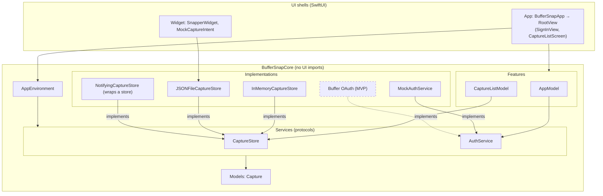
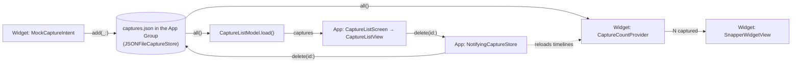

# Architecture

BufferSnap keeps its logic in **BufferSnapCore** (`Packages/BufferSnapCore`), a pure-Swift package with no UI
frameworks, so `just test-core` tests it on macOS in seconds without a simulator. The app and the widget are thin
SwiftUI shells over it.

- **Features** are `@Observable @MainActor` view models (`AppModel`, `CaptureListModel`): they hold the state and the
  actions on it.
- **Services** are `Sendable` protocols with `async throws` methods (`CaptureStore`, `AuthService`). Each one starts
  with a mock or in-memory implementation, and a real one replaces it later without touching the models.
  `JSONFileCaptureStore` is the first real one.
- **`AppEnvironment`** bundles the services. `BufferSnapApp` builds it once, as the composition root, and is the
  only place that picks which implementations run.
- **Models** are plain `Sendable` values (`Capture`).
- **Views** (`App/Views/`) only render. `RootView` switches on `AppModel.route`; a screen (`CaptureListScreen`) owns
  its feature model and feeds a stateless view (`CaptureListView`) plain values and closures. Conventions:
  [`App/CLAUDE.md`](../App/CLAUDE.md).
- **The widget** (`Widget/`) is a WidgetKit extension: an App Intent per button and a timeline that reads the count.
  Conventions: [`Widget/CLAUDE.md`](../Widget/CLAUDE.md).

Why: [`5-spm-core.md`](decisions/5-spm-core.md), [`5-core-ui-import-lint.md`](decisions/5-core-ui-import-lint.md).

## Layers

Arrows point from a layer to what it uses. Dashed boxes and arrows don't exist yet.

## Data flow

A capture made in the widget is written to the shared App Group store, and WidgetKit then reloads the widget's count.
When the app's list loads, or the app returns to the foreground, it reads every capture from that store and shows them
newest first. A delete in the app goes through `NotifyingCaptureStore`, which reloads the widget's timelines after the
write. The store contract is in [`Widget/CLAUDE.md`](../Widget/CLAUDE.md).
