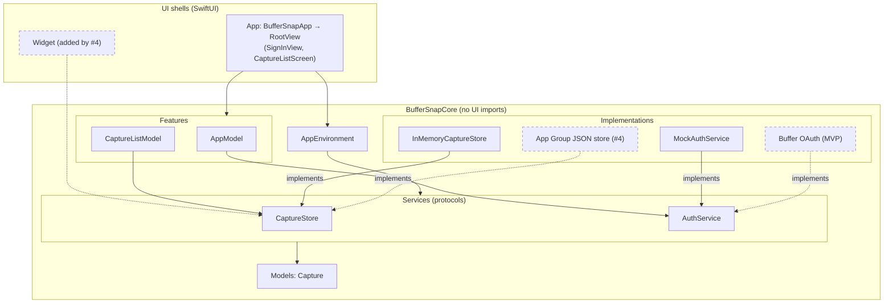
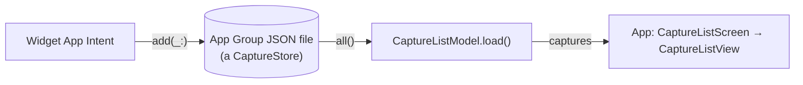

# Architecture

BufferSnap keeps its logic in **BufferSnapCore** (`Packages/BufferSnapCore`), a pure-Swift package with no UI
frameworks, so `just test-core` tests it on macOS in seconds without a simulator. The app (and later the widget) is
a thin SwiftUI shell over it.

- **Features** are `@Observable @MainActor` view models (`AppModel`, `CaptureListModel`): they hold the state and the
  actions on it.
- **Services** are `Sendable` protocols with `async throws` methods (`CaptureStore`, `AuthService`). Each one starts
  with a mock or in-memory implementation, and a real one replaces it later without touching the models.
- **`AppEnvironment`** bundles the services. `BufferSnapApp` builds it once, as the composition root, and is the
  only place that picks which implementations run.
- **Models** are plain `Sendable` values (`Capture`).
- **Views** (`App/Views/`) only render. `RootView` switches on `AppModel.route`; a screen (`CaptureListScreen`) owns
  its feature model and feeds a stateless view (`CaptureListView`) plain values and closures. Conventions:
  [`App/CLAUDE.md`](../App/CLAUDE.md).

Why: [`5-spm-core.md`](decisions/5-spm-core.md), [`5-core-ui-import-lint.md`](decisions/5-core-ui-import-lint.md).

## Layers

Arrows point from a layer to what it uses. Dashed boxes and arrows don't exist yet.

## Data flow

**Added by #4.** Until it lands, the app runs on `InMemoryCaptureStore`, so nothing crosses processes yet.

A capture made in the widget is written to the shared App Group store. When the app's list loads, it reads every
capture from that store and shows them newest first.
