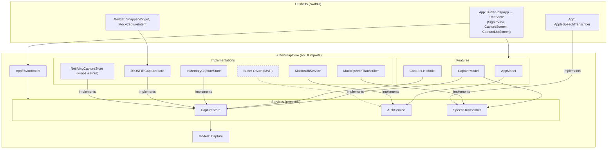
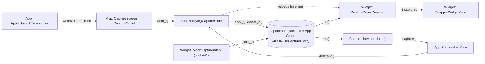

# Architecture

BufferSnap keeps its logic in **BufferSnapCore** (`Packages/BufferSnapCore`), a pure-Swift package with no UI
frameworks, so `just test-core` tests it on macOS in seconds without a simulator. The app and the widget are thin
SwiftUI shells over it.

- **Features** are `@Observable @MainActor` view models (`AppModel`, `CaptureModel`, `CaptureListModel`): they hold
  the state and the actions on it.
- **Services** are `Sendable` protocols with `async throws` methods (`CaptureStore`, `AuthService`,
  `SpeechTranscriber`). Each one starts with a mock or in-memory implementation, and a real one replaces it later
  without touching the models. `JSONFileCaptureStore` is the first real one. `AppleSpeechTranscriber` lives in the app
  rather than Core, because `AVAudioSession` doesn't exist on macOS, where Core's tests run.
- **`AppEnvironment`** bundles the services. `BufferSnapApp` builds it once, as the composition root, and is the
  only place that picks which implementations run.
- **Models** are plain `Sendable` values (`Capture`).
- **Views** (`App/Views/`) only render. `RootView` shows what `AppModel.route` names: sign-in, then the capture screen
  with the capture list pushed on top of it. A screen (`CaptureScreen`, `CaptureListScreen`) owns its feature model
  and feeds a stateless view (`CaptureView`, `CaptureListView`) plain values and closures. Conventions:
  [`App/CLAUDE.md`](../App/CLAUDE.md).
- **The widget** (`Widget/`) is a WidgetKit extension: an App Intent per button and a timeline that reads the count.
  Its buttons still make mock captures until #41 replaces them. Conventions: [`Widget/CLAUDE.md`](../Widget/CLAUDE.md).

Why: [`5-spm-core.md`](decisions/5-spm-core.md), [`5-core-ui-import-lint.md`](decisions/5-core-ui-import-lint.md).

## Layers

Arrows point from a layer to what it uses. Dashed boxes and arrows don't exist yet.

## Data flow

Holding the mic shows the words in the text box as they're heard, and releasing saves them through `CaptureModel`.
Nothing is saved if nothing was heard, and words that can't save on release stay in the box to edit
([`42-over-limit-dictation.md`](decisions/42-over-limit-dictation.md)). No audio is kept.

Typing an idea and tapping Save adds a pending text capture through `CaptureModel`. The write goes through
`NotifyingCaptureStore`, which reloads the widget's timelines afterwards, as a delete in the list does. When the list
opens, or the app returns to the foreground, it reads every capture from the store and shows them newest first.

The widget's mock buttons write to the same store until #41 replaces them, and WidgetKit then reloads the count. The
store contract is in [`Widget/CLAUDE.md`](../Widget/CLAUDE.md).

Installs from before #40 have a `captures.json` holding only mock captures. The app deletes it at launch and nothing
reads it: [`40-new-capture-file.md`](decisions/40-new-capture-file.md).
