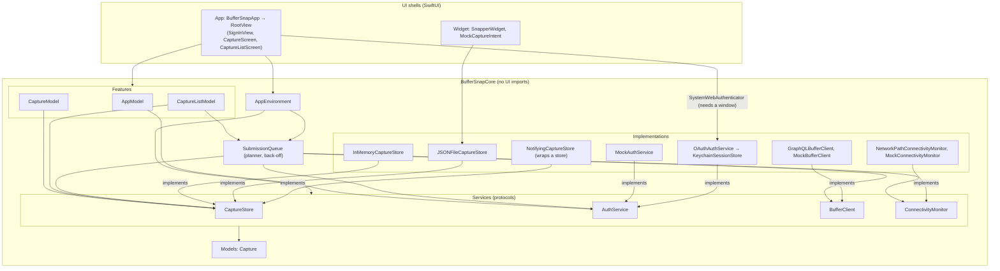
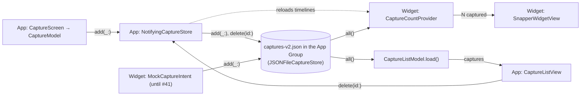
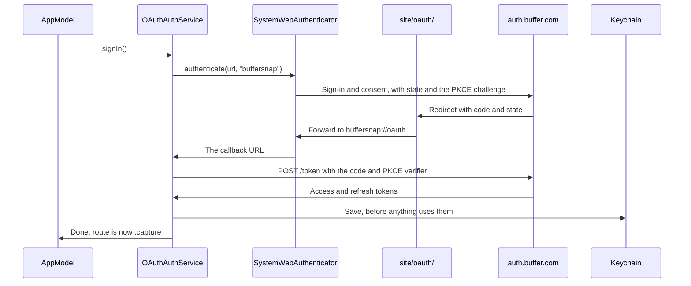
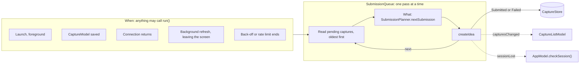

# Architecture

BufferSnap keeps its logic in **BufferSnapCore** (`Packages/BufferSnapCore`), a pure-Swift package with no UI
frameworks, so `just test-core` tests it on macOS in seconds without a simulator. The app and the widget are thin
SwiftUI shells over it.

- **Features** are `@Observable @MainActor` view models (`AppModel`, `CaptureModel`, `CaptureListModel`): they hold
  the state and the actions on it.
- **Services** are `Sendable` protocols with `async throws` methods (`CaptureStore`, `AuthService`, `BufferClient`,
  `ConnectivityMonitor`). Each one starts with a mock or in-memory implementation, and a real one replaces it later
  without touching the models. `JSONFileCaptureStore`, `OAuthAuthService`, `GraphQLBufferClient` and
  `NetworkPathConnectivityMonitor` are the real ones so far. `SubmissionQueue` is an actor on top of them.
- **`AppEnvironment`** bundles the services. `BufferSnapApp` builds it once, as the composition root, and is the
  only place that picks which implementations run.
- **Models** are plain `Sendable` values (`Capture`).
- **Views** (`App/Views/`) only render. `RootView` shows what `AppModel.route` names: sign-in, or the capture screen
  with the capture list pushed on top of it. A screen feeds a stateless view (`CaptureView`, `CaptureListView`) plain
  values and closures. `CaptureListScreen` owns its feature model, and `BufferSnapApp` owns `CaptureModel`, so a draft
  outlives the screen when a session ends. Conventions: [`App/CLAUDE.md`](../App/CLAUDE.md).
- **The widget** (`Widget/`) is a WidgetKit extension: an App Intent per button and a timeline that reads the count.
  Its buttons still make mock captures until #41 replaces them. Conventions: [`Widget/CLAUDE.md`](../Widget/CLAUDE.md).

Why: [`5-spm-core.md`](decisions/5-spm-core.md), [`5-core-ui-import-lint.md`](decisions/5-core-ui-import-lint.md).

## Layers

Arrows point from a layer to what it uses.

## Data flow

Typing an idea and tapping Save adds a pending text capture through `CaptureModel`. The write goes through
`NotifyingCaptureStore`, which reloads the widget's timelines afterwards, as a delete in the list does. When the list
opens, or the app returns to the foreground, it reads every capture from the store and shows them newest first.

## Signing in

`AppModel` picks its first route from `hasSavedSession()`, which reads the Keychain, so the first frame is already right.
When the scene becomes active, `checkSession()` asks for a valid token, which refreshes it if it's due. Only Buffer
rejecting the refresh token sends the user back to sign-in. Everything that needs a token calls `validAccessToken()`,
and `OAuthAuthService` makes sure only one refresh ever runs, because reusing a refresh token revokes the session:
[`43-single-use-refresh-tokens.md`](decisions/43-single-use-refresh-tokens.md).

## Sending to Buffer

`SubmissionQueue` asks `validAccessToken()` for a token and reports a 401 with `accessTokenRejected(_:)`. Each pass looks up the organization once. A capture stays `pending` until Buffer has it (`submitted`) or it can't get there without someone stepping in (`failed`). What each failure leads to: [`44-what-gets-retried.md`](decisions/44-what-gets-retried.md). Why a lost response can leave a duplicate: [`44-duplicate-ideas.md`](decisions/44-duplicate-ideas.md).

All of this runs in the app's process, on the one `AuthService`: [`44-background-sending.md`](decisions/44-background-sending.md). Before any sign-in, pending captures turn to `failed`, so they can't reach the next account by themselves: [`44-hold-captures-at-sign-in.md`](decisions/44-hold-captures-at-sign-in.md).

To change what gets sent, as #45 will, implement `SubmissionPlanner`. Its result names the captures, and all of them change status together.

## The widget's store

The widget's mock buttons write to the same store until #41 replaces them, and WidgetKit then reloads the count. The
store contract is in [`Widget/CLAUDE.md`](../Widget/CLAUDE.md).

Installs from before #40 have a `captures.json` holding only mock captures. The app deletes it at launch and nothing
reads it: [`40-new-capture-file.md`](decisions/40-new-capture-file.md).
