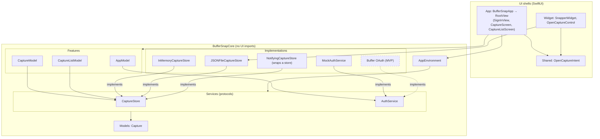
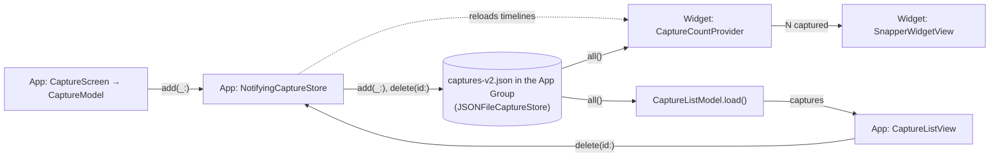
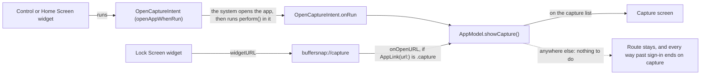

# Architecture

BufferSnap keeps its logic in **BufferSnapCore** (`Packages/BufferSnapCore`), a pure-Swift package with no UI
frameworks, so `just test-core` tests it on macOS in seconds without a simulator. The app and the widget are thin
SwiftUI shells over it.

- **Features** are `@Observable @MainActor` view models (`AppModel`, `CaptureModel`, `CaptureListModel`): they hold
  the state and the actions on it.
- **Services** are `Sendable` protocols with `async throws` methods (`CaptureStore`, `AuthService`). Each one starts
  with a mock or in-memory implementation, and a real one replaces it later without touching the models.
  `JSONFileCaptureStore` is the first real one.
- **`AppEnvironment`** bundles the services. `BufferSnapApp` builds it once, as the composition root, and is the
  only place that picks which implementations run.
- **Models** are plain `Sendable` values (`Capture`).
- **Views** (`App/Views/`) only render. `RootView` shows what `AppModel.route` names: sign-in, then the capture screen
  with the capture list pushed on top of it. A screen (`CaptureScreen`, `CaptureListScreen`) owns its feature model
  and feeds a stateless view (`CaptureView`, `CaptureListView`) plain values and closures. Conventions:
  [`App/CLAUDE.md`](../App/CLAUDE.md).
- **The widget** (`Widget/`) is a WidgetKit extension: a control, a widget for the Home Screen, Today View and Lock
  Screen, and a timeline that reads the count. The control and the Home Screen widget run `OpenCaptureIntent` (`Shared/`,
  compiled into both the app and the widget), and the Lock Screen widget opens `buffersnap://capture`. Both open the
  app on the capture screen. Conventions:
  [`Widget/CLAUDE.md`](../Widget/CLAUDE.md).

Why: [`5-spm-core.md`](decisions/5-spm-core.md), [`5-core-ui-import-lint.md`](decisions/5-core-ui-import-lint.md).

## Layers

Arrows point from a layer to what it uses. Dashed boxes and arrows don't exist yet.

## Data flow

Typing an idea and tapping Save adds a pending text capture through `CaptureModel`. The write goes through
`NotifyingCaptureStore`, which reloads the widget's timelines afterwards, as a delete in the list does. When the list
opens, or the app returns to the foreground, it reads every capture from the store and shows them newest first.

The widget only reads the store. The store contract is in [`Widget/CLAUDE.md`](../Widget/CLAUDE.md).

Installs from before #40 have a `captures.json` holding only mock captures. The app deletes it at launch and nothing
reads it: [`40-new-capture-file.md`](decisions/40-new-capture-file.md). Installs from between #40 and #41 can have mock
captures among real ones in `captures-v2.json`, and the app deletes just those at launch:
[`41-remove-mock-captures-by-text.md`](decisions/41-remove-mock-captures-by-text.md).

## Opening the capture screen

From a locked phone, the system asks to unlock first, since the intent isn't always allowed, and a widget tap always
needs an unlock to open the app. The Lock Screen widget uses a URL because its intent button didn't run on a device:
[`41-lock-screen-widget-url.md`](decisions/41-lock-screen-widget-url.md). A cold launch reaches
capture whichever comes first, the intent or getting past sign-in:
[`41-no-remembered-capture-request.md`](decisions/41-no-remembered-capture-request.md).
